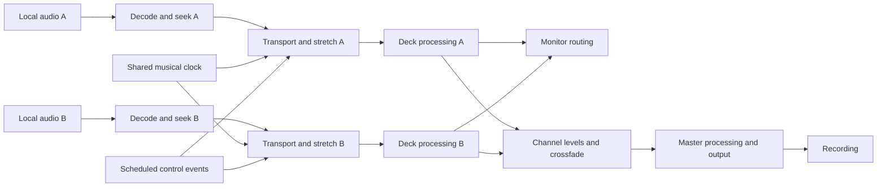

# Traktor DJ 1.x product and technical specification

Scope reviewed on 30 October 2026: this document records original-product requirements or dated reference research. It does not certify current replica implementation. See [current shared implementation and verification](../../Replica/Status.md). Original evidence dates and unresolved fidelity requirements are retained.

Target: original iPad Traktor DJ, with installed 1.6.8 as the reference. Evidence labels and source keys are defined in [the research index](README.md).

The [performer fidelity specification](15-performer-fidelity-specification.md) governs implementation. Next-track suggestions, analysis and gridding are central. Preserve the performer's reported genre/history-aware adaptive rankings [R2]. Proposed architecture below does not authorise new product behaviour, changed quirks or replacement recommendation policies [R3].

## Current performance requirement — user clarification, 26 October 2026

The combined audio output thread is the number-one priority at all times. Playing and performing music must stay responsive on the original iPad Pro, including while recording and analysing tracks. On 28 October 2026, the user confirms the saved 10.5-inch iPad Pro (2017/A10X) as the minimum target. Analysis, search, artwork, import and all other secondary work must yield resources to audio and performance controls. Earlier descriptions of recommendations as a leading feature do not give recommendation work scheduling priority over playback.

Acceptance requires no missed output deadlines, crackle, dropped recording frames or other audio defects under the combined workload. Mac tests and SDK compilation are development checks; they do not establish this target-device acceptance. The parked gig iPad remains outside authorised testing.

## What made the design distinctive

Next-track suggestions lead this reconstruction. NI describes tempo, key and timbre as inputs. The performer reports genre's contribution and rankings that adapt with previous mixes and track combinations. Preserve that original accumulated experience, together with the analysis and gridding that support it. [S1, S15, S41, R2]

The app makes the waveform the instrument. The performer touches the musical material, chooses its visible scale, loops a region, and plays slices. Deck transport, mix controls, and timing remain close to that surface. NI's original documentation shows this across the deck, Freeze, and effect workflows. [S1 Chapter 5, S13]

The design's strength is the interaction between its parts. A shared tempo reduces repeated adjustment. A downbeat-aware grid makes timed navigation possible. Quantisation lets an intended action wait for a musical boundary. Flux separates a temporary performance gesture from the song's continuing position. Freeze turns visible audio into playable regions. The user can spend attention on phrasing, track choice, and sound. These are design conclusions, not claims that every competitor lacked the same individual features.

The user's early Play press is especially valuable. It allows the performer to commit the incoming launch, then move both hands to EQ or effects before the track enters. Recreating the feature means preserving its timing and cancellation rules, not merely adding a green Sync button. [R1]

| Design property | Consequence for the rebuild | Evidence |
| --- | --- | --- |
| Direct waveform control | Touch position and gesture meaning must track the musical display | D, S1 §§5.1.8, 5.2.7 |
| Two stacked decks | Preserve A above B and clear deck identity in overlays | D, S1 p76 |
| Central tempo workflow | Tap master BPM, then rotate the tempo wheel | D, S15 2:08–2:19. Fine response and limits V |
| Quantised performance | Queue applicable events in musical time | D for Hotcues, S1 §5.1.2. Play rule R/V |
| Persistent musical position | Keep Flux position independent of audible position | D, S1 §5.2.4, S5 |
| Scale determines playable detail | Zoom changes Freeze's musical granularity | D, S1 §5.2.7 |
| Contextual drawers | Reveal EQ, filter, and FX within the deck workflow | D, S1 §§5.1.5–5.1.6, 5.3 |
| Adaptive recommendations within browsing | Match original next-track ordering, compatibility feedback and the reported contribution of previous mixes | D tempo/key S1/S15, declared timbre S41, R genre/history and observed adaptation R2 |
| Hardware and touch cooperate | Parameters and feedback must share one state | D, S1–S5 |

## Product boundaries and version history

The installed target is not identical to launch 1.0. A historical feature must retain its release context. Some features were added, changed, unlocked, or removed during the 1.x period.

| Period | Scope to preserve | Status |
| --- | --- | --- |
| Original 2013 app | Two decks, waveform interaction, library, analysis, sync, cues, loops, Freeze, EQ/filter/FX | D across S1, S2, S11–S12 |
| 2013 controller integration | Z1, S2 MK2, S4 MK2 workflows, manual mixing, transport, more simultaneous controls | D, S1–S5 |
| 1.4 in April 2014 | Mixcloud integration, additional effects and usability work | D, S14. Extra names and unlock mechanics V, H3 |
| 1.5 in August 2014 | SuperSlicer | D, S10. History and grid refinements V, H1 |
| Later 1.x | Audiobus integration | V for exact role and transport behaviour, H2/H6 |
| 1.6.8 reference | iCloud in place of Dropbox, grid/cue/BPM/key backup and cross-iPad data | V pending reference settings or retained first-party release notes, H2/H7 |

Do not turn the eight choices in each of three early effect slots into “24 effects”. Later menus may contain more choices. Do not turn a four-button controller into an app cue limit. Do not require today's cloud services to work before local mixing can function.

Original Traktor Pro collection exchange is part of the historical story, but its later removal means it is not a dependable 1.6.8 workflow. Keep historical Dropbox exchange, later iCloud metadata, audio-file transfer, and recording uploads as four separate systems. [H2, H7, S13–S14]

## Reference technical facts

| Field | Known value | Limit |
| --- | --- | --- |
| App | Traktor DJ for iPad | Distinct from the iPhone app and DJ 2 |
| Version and build | 1.6.8 / 1.6.8.67 | L1 |
| Bundle | `com.native-instruments.traktordj` | L1 |
| Store ID | 592052832 | L1 |
| Architecture | arm64 reported in an existing resource diagnostic | L1. Binary architectures not inspected |
| Reference device | iPad Pro 10.5-inch, iPad7,3 | L1 |
| Reference OS | iPadOS 17.7.11 | Observed installed state, not a support guarantee |
| Metadata size field | 70,647,808 bytes | Not a memory or IPA-size measurement |
| System audio | Core Audio on iOS | D, S7 |
| Shared recordings examined | 26 WAV and 27 XML exports | L2 |
| WAV format examined | Stereo PCM, 44.1 kHz, 16-bit | L2. Internal format unknown |
| Shared tracklist fields | Artist, name, GUID, resource type, start time | L2. Units and identity rules unknown |
| iCloud entitlement | `iCloud.com.native-instruments.tdj` | L1. Capability does not prove current cloud behaviour |
| App group | `group.com.native-instruments.tdj` | L1. Group contents unknown |
| Inter-App Audio entitlement | Present | L1. Exact exposed integration V |
| Original device generation | Manuals list iPad 2 and later contemporary iPads | Historical compatibility only, S1/S3 |

The app's programming language, rendering library, decoder implementation, internal sample precision, callback size, memory model, time-stretch algorithm, filter coefficients, limiter, and private database layout remain unknown. No app executable has been inspected. No evidence here identifies a specific time-stretch vendor or algorithm.

## Screen and navigation model

### Main performance view

The 2013 manual shows stacked horizontal deck waveforms, a smaller track stripe, a central play marker, deck-level controls, and a vertical crossfader at the right. A is above B. EQ and FX drawers can occupy part of a deck's area. This establishes a visual arrangement, not exact 1.6.8 pixel positions. [S1 pp76–78, 92]

The reference inventory must capture these visible areas:

| Area | Information and controls to capture | Status |
| --- | --- | --- |
| Global header | Tempo, master/cue controls, browser, help/notifications, recording and system indicators | Tempo/audio D. Complete header V |
| Deck heading | Title, artist, artwork, BPM, key, elapsed/remaining time | Visible fields vary. Complete 1.6.8 list V |
| Main waveform | Audio detail, beat lines, bar/downbeat information, active loop, cues, touch state | D capability, exact rendering V |
| Track stripe | Whole-track context, current location, cues, loop, preview target | D navigation capability, touch rules V |
| Deck transport | Play/Pause, Sync, loop size, grid tools, Freeze, cue drawer, headphones | D capabilities. Exact placement V |
| EQ drawer | Low, Mid, High, Volume sliders, Filter tab | D visible in S1 p77 |
| Filter drawer | Cutoff/resonance XY surface and enabled state | D, S4 |
| FX drawer | Effect selections, XY control, state indicators, lock icons | D, S1 p92. Exact latch behaviour V |
| Browser | Category tree, tracks, musical recommendations, playlist operations | D, S1 §5.1.1. Touch rules V |
| Preferences | Playback defaults, audio routing, data/cloud, hardware and help options | Audio D. Full menu tree V |
| Recording view | Record state, saved recordings, playback/export/share/management | Recording L/D. Exact controls V |

NI's original touch tutorials now establish several exact routes. Swipe upward for the browser. Use the contextual load slider up for A or down for B. Tap destination-deck artwork for recommendations. Drag the red stripe window to preview, then tap a detailed-waveform beat to commit a timed jump. Pinch that stripe window to zoom. These gestures belong to distinct targets and modes. [S15 0:21–0:28, 1:21–2:04, 2:19–2:48]

### Navigation requirements for a faithful rebuild

These are proposed acceptance rules until measured:

1. Browsing must not stop or retime the audible deck.
2. Opening a drawer must not reset its hidden parameters.
3. The player must always be able to identify which deck an action affects.
4. Preview navigation must remain distinct from committing a seek.
5. Returning from a modal view must preserve useful deck and browser context.
6. A finger already controlling a deck must not silently transfer to an overlay that appears beneath it.
7. The visual state must distinguish an event that is queued from audio that has started.
8. UI redraw delays must not delay a scheduled audio event.

## Musical behaviour model

The implementation needs separate representations for **tempo**, **beat phase**, **bar phase**, **track position**, **audible position**, **Flux position**, **view position**, and **pending actions**.

For example, browsing ahead changes view position. It need not change the audible playhead. A loop constrains audible position. Flux can continue a separate song position. A pending Play command can exist before the audible playhead moves. A change to source BPM analysis must not be confused with changing global performance tempo.

The detailed model, including next-bar starts, is in [Transport sync and queued starts](03-transport-sync-and-queued-starts.md).

The [video review](07-ni-tutorial-video-findings.md) confirms the global tempo wheel and ordinary synced Play. It does not measure a one-bar Play wait. The reported next-bar behaviour remains a required scheduler contract with its exact conditions and cancellation rules still to capture.

## Audio processing requirements

The following architecture is proposed for an independent rebuild. It does not describe NI's private implementation.

This diagram shows functional responsibilities. The actual NI order of gain, EQ, filter, FX, cue taps, crossfade, limiter, and recording taps is **V**. Test each relevant order. A change in order can change the sound even when all controls look right.

Required engineering properties:

- Use audio sample time to execute transport events within a render buffer.
- Decode, analyse, allocate memory, write files, and perform network work away from the real-time callback.
- Smooth continuous parameter changes to avoid zipper noise and clicks.
- Keep a seekable PCM cache or equivalent buffering for hotcues, loops, backwards motion, and scratch gestures.
- Preserve stereo coherence during stretching and transient processing.
- Keep metadata analysis independent of destructive audio editing.
- Preserve musical clock phase across a tempo change unless the measured behaviour resets it.
- Handle route changes, interrupted audio sessions, and recording failures explicitly.
- Make output-device latency and stretch lookahead visible to the scheduler.
- Keep recording/file failures from blocking the playing audio.

None of these properties proves audio equivalence. Compare the rebuilt output with reference captures for transient attack, vocals, bass, cymbals, stereo image, tails, and extreme tempo changes.

### Time stretch and keylock

Keylock must be modelled independently from Sync. Changing playback speed without keylock changes pitch. Keylock compensates for that pitch change. Controller documentation explicitly permits keylock control and requires both Sync and Keylock off for its classic pitch-bend workflow. [S1 §§5.1.8, 5.2.1, S5]

Measure pitch, transient smearing, latency, seek behaviour, and release behaviour at several tempo ratios. Do not assume that matching “keylock on” reproduces the original's sound. The exact algorithm and tuning remain unknown.

### Mixer and effect calibration

Measure centre values, minimum/maximum gain, EQ crossover frequencies, kill depth, resonance, crossfade law, dry/wet law, effect timing divisions, tail handling, and limiter response. Capture each effect alone before comparing chains. Hardware availability may change which combinations can be engaged. [S1 §5.3, S4]

The installed effect menu still needs capture. NI's Performing tutorial directly names or shows Delay, Reverb, Flanger, Gater and Beatmasher 2. Other early candidates include Digital LoFi and high/low-pass effects. Later leads name Iceverb, Transpose Stretch and Reverse Grain. The complete installed names, unlock states and parameters remain **V**, not a measured eleven-effect manifest. [S16 2:27–3:11, H3/H5]

The original tutorials explicitly describe the delay continuing after its source deck stops. Preserve that tail in the documented transition, while measuring other effects and other transport actions separately. [S16 2:58–3:11, S17 3:44–4:04]

## Music library and persistence

A proposed data model should separate:

| Entity | Required information |
| --- | --- |
| Audio asset | Stable identity, source reference, availability, duration, format |
| Analysis | Source BPM, key, beatgrid anchor, downbeat, waveform cache, analysis version |
| Suggestion reference | Original context, ranked candidate identities and compatibility feedback for reference comparisons |
| Adaptive suggestion state | State needed to reproduce reported history-dependent rankings. Original representation and update rules remain unresolved |
| Cue | Slot, source position, cue type, optional loop extent |
| Playlist | Order, membership, name, folder relationship where supported |
| History session | Track entries and timing, with explicit rules for repeated loads and brief playback |
| Recording | Audio file, tracklist, start/end, finalisation state, export state |
| App preferences | Quantise and loop defaults, audio routing, display and hardware settings |
| Performance session | Loaded tracks, deck state, shared clock, drawer state, recoverable context |
| Cloud metadata | Version, device identity, revision, conflict state, source identity mapping |

This is a new schema. It is not a recovered NI database design. Existing recording XML does not establish how NI stores grids, cues or recommendation learning. Entitlements do not establish sync conflict rules. An iCloud collection, if later available, can be inspected read-only from a preserved copy.

The rebuilt library should survive a renamed or unavailable audio source without erasing its cues. Cloud availability must not be necessary for local performance. These are proposed reliability requirements. Compare them with the reference before labelling them fidelity requirements.

## Hardware scope

| Hardware family | Confirmed or bounded behaviour |
| --- | --- |
| Z1 original | Mixer, EQ/gain, filter or selected FX, cue mix/volume, MODE+CUE transport. D, S3/S4 |
| S2 MK2 | Decks A/B, four physical cue buttons, transport, jogs, loops, Freeze, FX. D, S2 |
| S4 MK2 | Decks A/B in this app, eight slice controls using Hotcue and Remix Slot buttons, quantise cycling, shared-tempo control. D, S1 |
| AUDIO 2 MK2 | iOS audio integration and limited volume/cue control. D, S7/S9 |
| Class-compliant multichannel interfaces | Separate Master/Monitor routing in principle. Particular hardware still needs validation. D, S6/S7 |
| S4 MK1 and older AUDIO 2/4/8 DJ families | Listed incompatible with original iOS app in S7 |
| Other controllers, generic MIDI, Bluetooth control | Support not established for this target |

The four-channel S4 hardware does not turn this into a four-deck app. Audio-interface recognition does not establish controller mapping. Preserve the hardware's exact model, firmware, adapter, power, and app version in every later test record.

## Rebuild sequence and completion criteria

This is a proposed sequence. It does not authorise device changes.

1. Establish suggestion reference cases, including the performer's observed adaptation. Preserve ranked identities and their context without accessing the gig iPad.
2. Reproduce library analysis, grid correction and preparation persistence. Use their original outputs in suggestion comparisons.
3. Reproduce the suggestion workflow and original rankings, including genre and history contributions. Resolve unknown rules against reference examples.
4. Implement the clock and event scheduler. Match bar launch, tempo changes, cancellation and other pending-action outcomes when their original rules are resolved.
5. Implement two seekable decks with loops, cues, Sync, keylock and Flux.
6. Build the waveform and touch model. Match visible scale, scrub/preview distinction and gesture arbitration.
7. Add Freeze and Loop Slicer as distinct modes. Add SuperSlicer after its mapping is captured.
8. Calibrate mixer, EQ/filter, effects, monitoring and audio routing. Preserve recording, history and export behaviour.
9. Reproduce each supported hardware profile and verify simultaneous touch operation.
10. Compare the complete journey catalogue against reference recordings. Keep ordinary functions and original quirks in scope.

A prototype is not complete because it can mix two tracks. Fidelity requires the recorded interactions and audible outcomes to pass, with outstanding uncertainties visible. The completion gate in the capture protocol defines what remains before that claim is justified.
