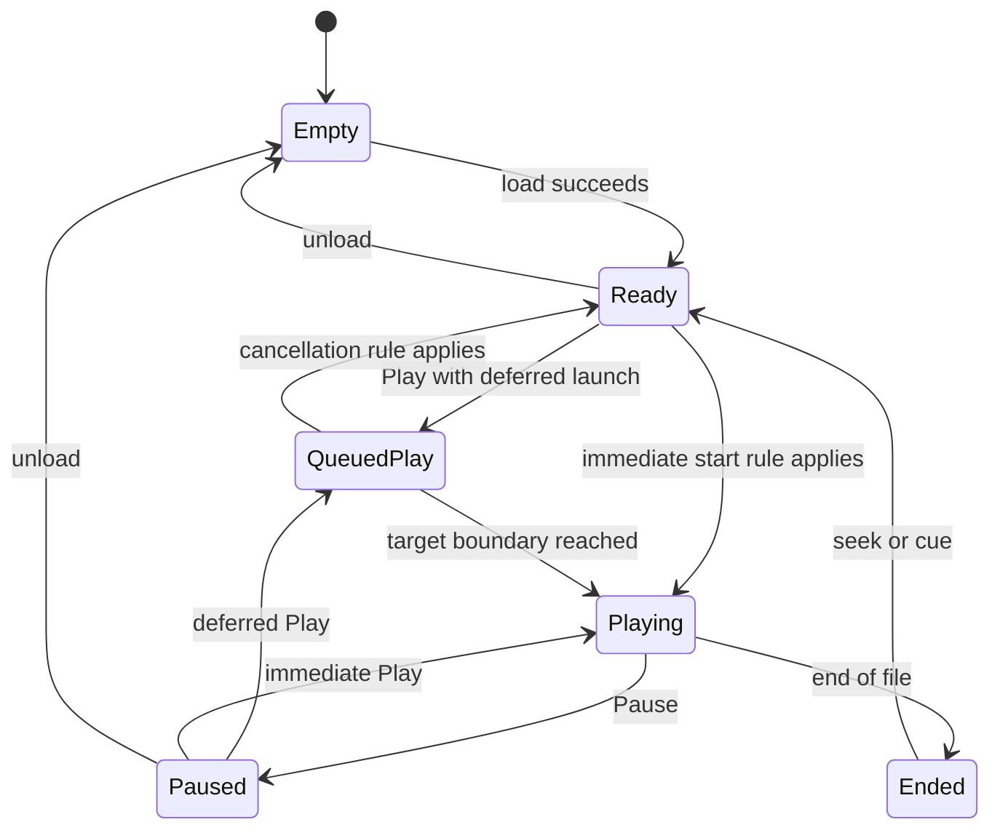

# Traktor DJ 1.x transport sync and queued starts

Scope reviewed on 30 October 2026: this document records original-product requirements or dated reference research. It does not certify current replica implementation. See [current shared implementation and verification](../../Replica/Status.md). Original evidence dates and unresolved fidelity requirements are retained.

This specification protects the timing behaviour that makes the app useful as a performance instrument. **D** is documented behaviour, **R** is the user's requirement, **P** is a proposed implementation model, and **V** is an unresolved reference rule.

Under the governing [fidelity specification](15-performer-fidelity-specification.md), proposed state transitions below are hypotheses. They must not become substitute product behaviour while the original rule remains unresolved. In particular, no proposed cancellation action establishes what a second Play actually does. [R3]

The early Play press must be treated as a musical event that can wait for a boundary. The exact original queue rules are not yet measured. The model below makes them explicit so they can be tested and implemented without decompiling the app.

## Current performer confirmation

On 28 October 2026, the performer confirmed that pressing Play again while a synced incoming deck waits cancels the pending start. The C transport implements and tests that rule. The historical evidence sections below retain their original uncertainty about video observations. They do not override this direct confirmation.

## Keep these functions separate

| Function | What it controls | What it does not establish |
| --- | --- | --- |
| Source BPM | Beat spacing in the analysed source track | Current output tempo |
| Master tempo | Shared musical clock speed | Correct downbeat or source grid |
| Tempo sync | Equal effective BPM | Beat or bar phase alignment |
| Beat phase sync | Alignment within one beat | Which beat is the first beat of a bar |
| Bar phase alignment | Alignment within the musical bar | Automatic 8/16/32-bar phrase recognition |
| Quantised execution | When an accepted action takes effect | Where its source cue or loop was placed |
| Grid snapping | Where a marker or boundary is stored | When a later trigger executes |
| Keylock | Pitch treatment when speed changes | Timing or grid correctness |
| Flux | Continuing song position during temporary manipulation | Quantisation or tempo detection |

These distinctions are needed by the rebuild even if the original exposes fewer separate switches. Do not invent a Snap toggle or a Traktor Pro Sync Mode preference for the original app without observing it.

## Documented foundation

NI's S4 app chapter documents a shared master clock adjustment, configurable Hotcue quantisation, Sync, half-sync, downbeat editing, and Flux. The NI basic controller tutorial says Sync aligns tempo and beatgrids. [S1 §§5.1.2, 5.2.3–5.2.4, S5]

**Half-sync is real product behaviour.** NI describes matching BPM with misaligned phase after an out-of-time scratch or cue action. The app's Sync indicator turns red. The controller's button flashes orange. Pressing Sync realigns it and restores green in the app. [S1 §5.2.3]

The manual's quantisation section establishes trigger delay for Hotcues, with a historical quarter-beat minimum. [S1 §5.1.2]

The [period review](08-period-reviews-and-quantised-play.md) adds explicit deferred-Play support [S20] and captures the iPad quantise menu/default [S21]. Their relationship remains open.

The [later 1.x review](09-later-1x-play-and-cancellation.md) extends menu evidence into 2017 [S30]. It does not resolve Play's preference mapping or queued-start cancellation.

The [forum/help review](10-archived-forums-and-in-app-help.md) recovers original NI help screenshots [S31] and a period firsthand Freeze-quantisation report [S32]. Neither establishes ordinary Play's policy or pending cancellation. Archived NI discussion retrieval did not succeed. Q02/Q05 remain open.

The [non-English review](11-non-english-walkthroughs.md) adds a visible 1.0.3.182 version label and a half-beat to one-beat selection change [S34]. French/German captions and selected Spanish scenes do not settle either Play rule. A preference change alone is insufficient evidence for a per-command timing policy.

The [adjacent-frame follow-up](12-french-spanish-frame-review.md) shows intermediate French selections and a Spanish incoming-deck lead-in [S34/S35]. In S35, Play is green while a pale marker moves toward the source start, before waveform scrolling. This establishes a UI sequence, not its exact audio onset, bar anchor or Quantize Size mapping. No identifiable second accepted press establishes cancellation.

The [Hollin frame review](14-hollin-jones-count-in-frame-review.md) independently supports that lead-in sequence [S38]. One uninterrupted orange indicator event is visible, with no distinct second activation before source scrolling. The first clear green Play frame precedes the indicator's onset, so the indicator cannot establish input acceptance timing. No cancellation rule or quantise mapping is promoted.

The follow-up [NI video review](07-ni-tutorial-video-findings.md) directly confirms the touch tempo wheel and demonstrations of ordinary synced Play. It does not establish Play's quantise interval. At Performing 2:07.36 the incoming deck appears stopped. At 2:08.16 it is playing. The edited footage does not expose a clear input contact or quantise setting, so that interval must not be treated as a measured queue duration. [S15–S17]

## Master tempo and keylock

### Shared performance tempo

The shared tempo must remain a first-class control. NI's Browsing tutorial explicitly instructs the user to tap master BPM and rotate the tempo wheel to change the playing tracks smoothly. This closes the touch-entry and basic gesture gap. [S15 2:08–2:19]

NI also documents MASTER plus BROWSE on S4 for changing the clock. It states that adjusting a playing track's controller tempo affects the global tempo. [S1 §§5.1.8, 5.2.3]

Do not assume the original uses the same automatic master-deck handover rules as current Traktor Pro. Measure:

- How the initial global tempo is chosen.
- Whether loading a track can change it before playback.
- What happens when the first track starts or the last track stops.
- Which decks follow the clock with different Sync combinations.
- Whether the clock runs silently while both decks are stopped.
- Whether the tempo dial, a deck's tempo fader, and Reset have identical scope.
- The wheel's precise step size, response curve, touch anchor and any inertia.
- Whether a large change chooses a half/double interpretation.

### Keylock

Keylock is independent of Sync. The controller shortcut is SHIFT+PLAY. NI's classic-mixing workflow requires both Sync and Keylock off before jog pitch bend. [S1 §§5.1.8, 5.2.1, S5]

Measure whether enabling Keylock locks original pitch or the pitch at the instant of enabling. Also measure whether disabling it causes an immediate pitch change, a ramp, or a transport-specific transition. Source key metadata, keylock state, and a SuperSlicer pitch effect are three different things.

## The required early Play journey

Required user outcome, **R**, with historical documentary support **D S20**:

1. A track is already playing to the shared clock.
2. The incoming track is positioned at the intended cue and has the required Sync state.
3. The performer presses Play before the next bar.
4. The incoming track waits for the relevant musical boundary.
5. It starts at that boundary, so the performer can already have moved to EQ or FX.

The historical lead-in is now partly documented as **F143**. Capture its moving marker separately from source position and first audio. A green Play control must not be used as the sole evidence that the source has begun sounding. The proposed queued state below must accommodate that feedback without assuming the original engine's internal state names.

Exact UI and engine behaviour still to verify:

| Question | Why it matters |
| --- | --- |
| Which Play states and settings produce the deferred start? | Historical bar-entry support does not establish all conditional rules |
| Does the quantise setting affect Play, Hotcues, loops, Pause, or only a subset? | One universal event rule may be inaccurate |
| Does the track remain silent and stationary while waiting? | “Started with delayed audibility” differs from a deferred transport |
| Is the boundary the next clock bar or a grid-relative interval? | A wrong origin can launch a whole bar out of phrase |
| Is source beat phase preserved from the selected cue? | Cue on beat 3 must not be silently relabelled beat 1 |
| What happens if tempo changes while waiting? | A beat target and a fixed millisecond delay diverge |
| What happens if both decks stop while B waits? | A queued command needs a defined fate |
| Can multiple commands be queued per deck? | Last-wins, first-wins and FIFO sound different |
| What happens exactly on a boundary? | Small timing differences can create a full extra bar of delay |
| Is the control action accepted on finger-down or finger-up? | This affects the human timing window |

## Proposed clock representation

Use a monotonic audio sample timeline and a musical beat position. A useful model is:

```text
sample_position N
output_sample_rate Fs
master_beat B(N)
master_tempo T(N) in beats per minute
bar_origin B0
beats_per_bar M
quantise_interval Q in beats
action_scheduling_policy
```

For constant tempo over a render segment:

```text
B(N + dN) = B(N) + dN * T / (60 * Fs)
```

For tempo changes, integrate successive tempo segments. Maintain phase continuity unless a distinct reference action resets phase. A display timer, animation clock, or JavaScript timeout must not define audio timing.

For a future quantise boundary, one candidate rule is:

```text
k = floor((Brequest - B0) / Q) + 1
Btarget = B0 + k * Q
```

This selects the strictly next boundary. A different rule may include the current boundary within a measured acceptance window. The original's exact-boundary and near-boundary policy is **V**. Do not hide it inside an arbitrary epsilon.

Do not assign Q from the preference to every command automatically. Test a separate Play policy against preference-dependent and source-phase-dependent alternatives.

When Q is four beats in 4/4 and B0 is a bar origin, the boundaries coincide with bars. Four-beat quantisation is not automatically correct bar alignment if B0 is wrong.

### Example at 120 BPM

Each beat lasts 0.5 seconds. A four-beat bar lasts 2 seconds. If an action is accepted at master beat 10.5 and its next boundary is beat 12, it waits 1.5 beats, or 0.75 seconds.

```text
Master beat      8       9       10      11      12      13
Bar start        |                               |
Play press                          ^ at 10.5
Incoming deck                       queued ...... START
Wait                                               0.75 s
```

This is a proposed illustration of the user's requirement. It is not a measured Traktor trace. At 128 BPM, a beat is 0.46875 seconds and a four-beat bar is 1.875 seconds.

## Scheduling and audible alignment

Store the target in **musical time** when an action is meant to follow tempo changes. Resolve that target against audio sample time as the clock advances. Storing “start 750 ms later” at button-press time will fail if the performer changes tempo before launch.

If the target falls inside the next audio buffer, split processing at the target frame. Execute at the event's frame offset. Do not round to the start or end of the whole buffer.

Define the target at a common signal reference, such as the master mix sample. Account for different decoder/stretch/lookahead delays between decks. Shared output-device latency shifts both decks together, so it should not be subtracted from only the incoming deck. Any required pre-roll must be ready before its audible deadline.

Separate these timestamps in a trace:

1. Physical input or OS input timestamp.
2. UI recognition of the gesture.
3. Engine acceptance of the command.
4. Scheduled master beat and sample target.
5. Transport state transition.
6. First intended audio at the common mix reference.
7. Output at the electrical or acoustic measurement point.

Quantised waiting is intentional delay. Input latency and scheduler error are separate quantities. Measure all three before deciding that a control feels slow.

## Proposed deck state model

The state names below belong to the proposed rebuild.



Sync state, loop state, performance mode, Flux state, cue selection, preview navigation, and audio-route state are separate dimensions. They should not all be collapsed into this transport state machine.

Recommended command fields:

```text
command_id
deck_id
track_id
deck_load_generation
command_type
input_timestamp
accepted_master_beat
source_target_frame
target_master_beat or immediate policy
captured_quantise_value
cancellation_group
```

The load generation rejects a stale action after a different track loads. It also prevents a slow analysis or UI callback from starting the wrong file. Whether changing quantise after acceptance changes a pending event is a **reference question**, not a settled captured-value rule.

### Pending command decisions

| Intervening action | Proposed safe model | Original rule |
| --- | --- | --- |
| Load a different track | Invalidate commands for the old load generation | V |
| Second Play press while a synced incoming deck waits | Cancel the pending start | Direct performer confirmation, 28 October 2026 |
| New Hotcue | Replace or independently schedule according to measured policy | V |
| Seek or change selected cue | Decide whether pending source position is captured or live | V |
| Change tempo | Recompute sample deadline from musical target | V |
| Change quantise | Explicit captured-value or live-value policy | V |
| Disable Sync | Define cancel, immediate launch, or retained target | V |
| Stop master/last playing track | Define clock continuity and queued event fate | V |
| Change audio route | Keep logical clock and output alignment policy explicit | V |
| Application interruption | Suspend or cancel according to interruption handling | V |

The proposed rebuild must show a queued state clearly. Its exact icon, colour, pulse and cancellation indication should follow captured 1.6.8 behaviour where available. If the original has no separate indication, document that before deciding whether to add one.

## Source position and bar phase

A source position is an audio-frame coordinate. A beatgrid maps that coordinate to a musical position. A cue placed halfway through a beat can retain a fractional phase. A cue on the third beat of a bar also has a bar phase.

Test at least four cue positions: beat 1, beat 3, halfway through a beat, and a pickup before the grid origin. For each, distinguish:

- The execution boundary on the master clock.
- The exact source audio position selected.
- Any phase correction the Sync engine applies.
- Whether the app advances or rewinds the source to match bar phase.

Do not force every cue's first audible sound to be a downbeat merely because the trigger was quantised to a bar. That can destroy pickups or deliberately offbeat cues.

Grid editing changes the interpretation of source time. It should not automatically be assumed to move stored cue samples. Capture which reference items move, remain fixed, or are reinterpreted when BPM, grid offset, or downbeat changes.

## Flux and temporary manipulation

NI's tutorial describes a continuing song position while cues, loops, or scratches temporarily change the audible result. When the temporary action ends, the deck returns to where uninterrupted playback would have reached. [S5]

The proposed model therefore has at least two source positions:

```text
audible_source_position
continuing_source_position
```

The continuing position advances at the deck's effective speed. It can advance through several loop repetitions. It must follow tempo changes. A fixed “return to original cue” bookmark is not equivalent to Flux.

Capture overlapping operations. If a finger holds a slice while another finger changes a loop, the system needs a precise definition of the gesture or control that owns the return. Do not treat any finger-up event as “all manipulation ended”.

A persistent loop, a momentary loop roll, ordinary Freeze, Loop Slicer and SuperSlicer can sound similar during a short example. Their exit rules distinguish them. Record their complete entry, hold, release, exit, and later-track position.

## Timing acceptance scenarios

These are proposed tests. A reference capture supplies the final expected values.

| Test | Setup and action | Required result or measurement |
| --- | --- | --- |
| T01 | A plays, B cued on beat 1, bar quantise selected, early Play | Reproduce the user's next-bar launch |
| T02 | Press at several offsets throughout the preceding bar | Measure whether all target the same boundary |
| T03 | Press just before, exactly at, and just after a boundary | Establish acceptance window and action edge |
| T04 | Set every quantise value and repeat Play/Hotcue/loop/Pause | Produce a per-command quantisation matrix |
| T05 | Queue B, then press Play again before launch | Confirm the performer-reported cancellation and capture exact feedback/timing |
| T06 | Queue B, then change cue or seek | Establish source-target capture policy |
| T07 | Queue B, then load another track | No stale action may launch the old track in the rebuild |
| T08 | Queue B, then ramp 120 to 128 BPM | Determine musical-time versus wall-time target |
| T09 | Queue B, then stop A | Establish silent clock and pending command fate |
| T10 | Queue B, then change quantise or disable Sync | Establish pending-event update policy |
| T11 | Cue B on beat 3, an offbeat and a pickup | Preserve the observed source/bar-phase treatment |
| T12 | Unsync, scratch out of time, release, then press Sync | Reproduce half-sync state and correction |
| T13 | Flux cue/loop/scratch for several bars | Return to the continuing musical position |
| T14 | Change tempo during a Flux gesture | Continuing position must match the observed tempo path |
| T15 | Start with both decks stopped and repeat after a stop | Establish clock origin and first-deck behaviour |
| T16 | Repeat under UI load and through the hardware Play control | Audio timing must match the reference policy independently of UI redraw |

Record input-to-event latency, alignment error, jitter, quantised wait, and device latency separately. Set numerical fidelity tolerances after measuring the reference. A reasonable engineering target for the internal scheduler is sample-accurate execution within the chosen timing model. That does not claim sample-accurate human input or identical proprietary DSP.
