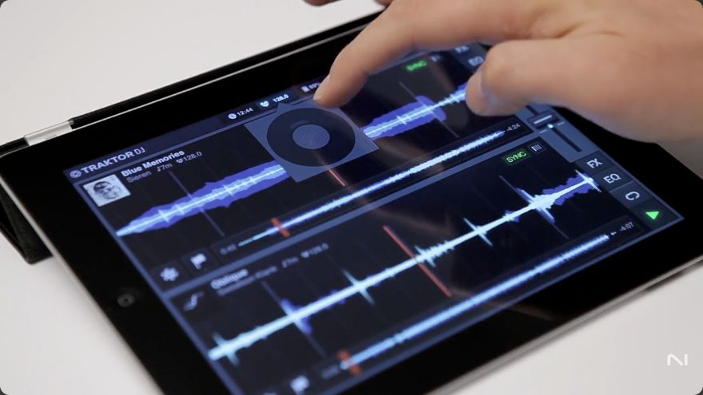
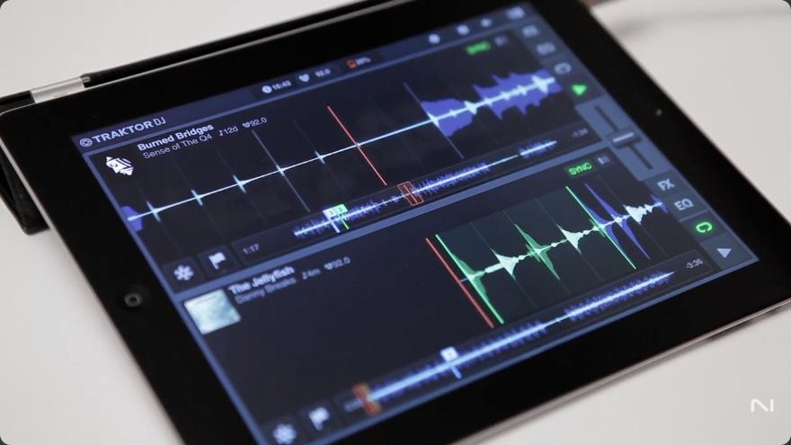
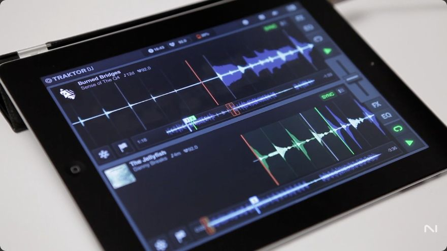
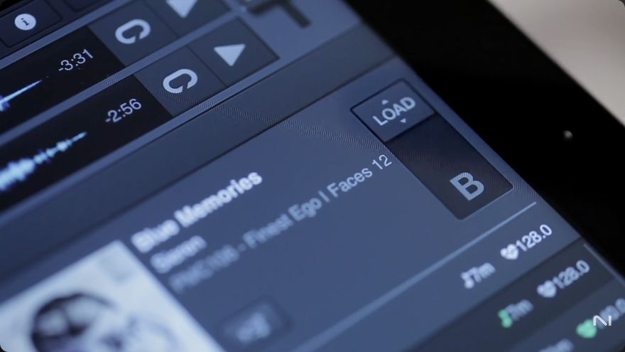
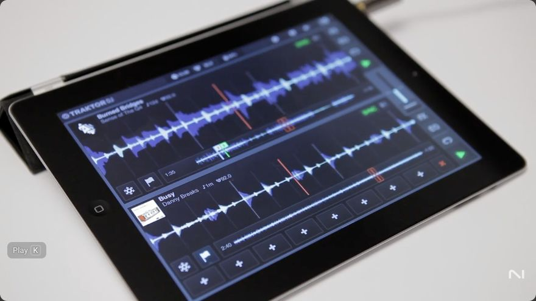

# Original NI tutorial video findings

Scope reviewed on 30 October 2026: this document records original-product requirements or dated reference research. It does not certify current replica implementation. See [current shared implementation and verification](../../Replica/Status.md). Original evidence dates and unresolved fidelity requirements are retained.

Reviewed on 21 October 2026 using the Mac browser. No iPad connection, device tool, app change, or jailbreak operation was used.

Six instructional videos were read through their complete English caption tracks. Selected app demonstrations were also inspected visually, including frame stepping through the incoming-deck launch. The SuperSlicer announcement has little useful speech, so its selected frames provide only limited visual evidence. Caption exports identify the four early touch tutorials as auto-generated and the two controller tutorials as authored or unspecified. Transcription errors and edited demonstrations do not establish precise engine timing.

These findings describe the tutorial-era app. The installed 1.6.8 reference still needs later confirmation for version-sensitive details. Source IDs below resolve in [Sources and evidence](06-sources-and-evidence.md). Video and frame provenance is recorded in [the tutorial manifest](sources/tutorial-manifest.json).

## Master tempo is now directly documented

The [Browsing tutorial at 2:08–2:19](https://www.youtube.com/watch?v=U2exstE0GmQ&t=128s) gives an explicit touch workflow: tap the global BPM display, open the circular tempo control, and rotate it to adjust the playing tracks smoothly. The frame at 2:14 shows the wheel beneath the header. **D, S15**.

The [Preparation tutorial at 0:48–1:06](https://www.youtube.com/watch?v=i5OZGtHZz_E&t=48s) explains that track analysis supplies tempo/key information and grids. Synchronisation relates those grids to the master tempo and their positions. **D, S11**.

This closes the uncertainty about the touch entry and wheel gesture. It does not establish the wheel's full range, numerical step, acceleration, touch anchor, clock initialisation, silent-clock behaviour, or master-deck handover. Those remain reference questions. Keylock remains a separate function.

## What the videos establish about Play and the next bar

The [Performing tutorial at 1:56–2:14](https://www.youtube.com/watch?v=B_8eahCGr1k&t=116s) loads the incoming deck, prepares an opening loop, and uses ordinary Play while NI describes automatic synchronisation. The [controller basics at 1:05–1:21](https://www.youtube.com/watch?v=3U7LqCkYeWc&t=65s) explicitly connect Play and Sync with matching tempo and aligning grids. **D, S16/S5**.

The [Essential Mixing tutorial at 1:30–1:40](https://www.youtube.com/watch?v=tHX-IvmbfJE&t=90s) also demonstrates starting the second track and attributes its timing to the app. It does not name a quantise interval. **D, S17**.

### Launch frames inspected

| Source-video time | Visible state | What it supports |
| --- | --- | --- |
| Performing 2:03.60, 2:06.16, 2:06.76 and 2:07.36 | Incoming deck has a prepared green loop and an inactive Play triangle | A prepared, non-playing incoming deck |
| Performing 2:08.16 | Incoming Play triangle is green and source progress has advanced | The incoming deck has started |

These are positions in an edited YouTube video, not input timestamps from the app. The inspected interval does not show a sufficiently clear button contact or the quantise setting. The before/after interval is **not** a measured queue duration. It cannot distinguish next-beat, next-bar, or other alignment policies.

The later [period review](08-period-reviews-and-quantised-play.md) strengthens the evidence for the user's workflow. The limits below apply to the NI videos reviewed here. They do not settle:

- Which quantise settings govern Play, Pause, Hotcues and loop entry/exit.
- Whether a pending Play freezes source position and remains silent.
- How a second press, cue change, seek, new load or Sync change affects it.
- Whether tempo changes move its deadline in musical time.
- What happens at the exact boundary or when the last playing deck stops.

Preserve the required queued-start model. Do not replace it with immediate playback merely because these demonstrations do not expose its internals.

## Newly documented touch workflows

| Area | Tutorial evidence | Behaviour now supported | Still open |
| --- | --- | --- | --- |
| Browser entry | S15 0:21–0:28 | Swipe upward to reveal the browser | Gesture start region and threshold |
| Sorting | S15 0:38–0:51 | Sort through name, album, artist, key and BPM controls | Tie order and direction switching |
| Fast scrolling | S15 1:02–1:12 | Drag the list, or grab its right-side scrollbar | Acceleration and selection retention |
| Search | S15 1:14–1:19 | Search for tracks or artists | Exact matching and normalisation |
| Deck loading | S15 1:21–1:31 | Touch a track, move the contextual load slider upward for A or downward for B | Release/cancel rules and overwrite protection |
| Recommendation entry | S15 1:34–2:04 | Tap artwork on the destination deck to open recommendations | Context after later selection changes |
| Recommendation feedback | S15 1:51–2:01 | Green indicators show compatible key, tempo, or both | Ranking, thresholds and ties |
| Navigation preview | S15 2:19–2:36 | Drag the red stripe window, release, then tap a beat in the detailed waveform to commit a timed jump | Cancel path and precise quantisation |
| Waveform zoom | S15 2:39–2:48 | Pinch the red stripe window with two fingers | Zoom limits and anchor |
| Playlist creation | S15 2:51–3:18 | Edit the track list, tick tracks, choose Add to Playlist, then select or create a playlist | Naming, deletion, ordering and folders |
| Help | S15 3:23–3:29 | Notification Centre offers guided feature instructions | Complete message catalogue |
| Grid correction | S11 1:15–1:42 | Move the waveform against the grid, halve/double detected BPM, or use tap tempo | Precision, persistence and commit rules |
| Grid inspection | S11 1:42–1:51 | Inspect the track in four-beat increments | Touch control details and boundary clamps |
| Cue drawer | S11 2:01–2:16 | Eight Hotcue slots, set by tapping an available slot | Deletion, grid-slot occupancy and stopped recall |
| Hot loop recall | S11 2:16–2:21 | Recall jumps to the saved loop and activates it | Pending-trigger and Flux interaction |
| Waveform scrub | S16 0:31–0:45 | Touch to scrub, then release to return in musical time | Motion curve and conditions for that return |
| Freeze entry/exit | S16 0:49–1:11 | Snowflake button stops waveform scrolling while audio continues. Tap again to leave | Exact slice scale in every state |
| Touch loop creation | S16 1:18–1:22 | Two fingers define the desired loop region | Contact order and snapping |
| Touch loop movement | S16 1:22–1:26 | Hold with two fingers and move the loop | Step size and transport effect |
| Touch loop resizing | S16 1:26–1:31 | Hold the loop and pinch inward/outward | Retained anchor and available lengths |
| Loop Slicer | S16 1:31–1:51 | Enable Freeze within a loop, then tap/hold its slices. Freeze button exits slicing | Release, Flux and loop-exit rules |
| FX drawer | S16 2:27–2:37 | Tap FX. Its XY drawer enters from the left | Animation duration and touch arbitration |
| FX selection | S16 2:37–2:49 | Tap a displayed effect. Hold its selector and drag downward for more choices | Later 1.x menu contents |
| EQ drawer | S16 3:11–3:26 | EQ drawer enters from the right with Low, Mid and High controls | Exact gain curves |
| EQ reset | S16 3:26–3:31 | Tap the centre to reset | Hit area and volume-reset behaviour |
| Multitouch mixing | S16 3:31–3:35 | Sliders and XY pads support multitouch | Contact ownership and simultaneous limits |
| Filter lock | S16 3:38–4:01 | Filter is in the EQ panel and can be retained with a lock button. Filter and FX can be combined | Toggle sequence, retained values and FX-lock equivalence |
| Delay tail | S16 2:58–3:11, S17 3:44–4:04 | NI explicitly describes continuing delay while the source deck is stopped | Other effects, bypass and seek tails |

### Loop dismissal needs care

At Performing 1:49–1:56, the automatic captions describe turning off the loop with two fingers. A viewer comment disputes the finger count. A comment is not primary technical evidence, and this review did not establish a clear contact count from that scene. Keep loop dismissal's exact touch gesture **V**. The clearly described creation, movement and resizing gestures can still be promoted independently.

## Controller details strengthened by the original videos

| Topic | Source | Finding |
| --- | --- | --- |
| Manual mixing | S5 2:20–2:52 | Turn off both Sync and Keylock, then use the tempo fader and jog pitch bend |
| Three effects | S5 3:00–3:21 | Three FX can run together in the demonstrated controller-era version |
| Beatjump size | S5 3:28–3:46 | With no loop active, the loop-size control sets jump size and MOVE performs the jump |
| Cue deletion | S5 4:06–4:16 | SHIFT plus a stored Hotcue deletes it |
| Flux return | S5 4:22–4:46 | The continuing track position survives temporary cue, loop and scratch operations |
| Freeze access | S18 0:38–1:02 | Press MOVE for Freeze, SHIFT+rotate MOVE changes scale, and MOVE shifts assignments |
| Loop slices | S18 1:10–1:39 | The demonstrated loop slicing exposes eight parts on S4 and four on S2. Loop length changes slice size |
| Flux default | S18 1:22–1:28 | NI says Flux is enabled by default in this slicing demonstration. This does not establish an app-wide default |
| Navigation commit | S18 1:56–2:04 | SHIFT+jog chooses a highlighted bar. CUE commits a timed jump |
| Temporary grid editing | S18 2:11–2:26 | Hold SHIFT+SYNC to edit, adjust with the jog, then release to leave the mode |

The controller video describes its own mapping. Its four/eight available slices do not establish a universal touch slice count. Its wording about a clean navigation transition does not mean the changed musical content is inaudible.

## SuperSlicer evidence limits

The [NI announcement](https://www.youtube.com/watch?v=oRNAV-GlH18) was checked through its caption track and selected frames near 0:16, 0:48 and 1:04. The track is mainly music, with no useful spoken explanation of parameter mappings. The 0:16 frame shows a historical Features settings category beside Dropbox, Mixcloud and About. This is a partial 1.5-era menu observation, not a complete 1.6.8 settings tree.

It does not settle every SuperSlicer zone, pitch interval, scratch/brake response, multitouch override or release rule. Those remain Q20. The announcement's existing description remains the primary basis for its named Scratch, Brake, Reverse, Slice and Pitch-shift capabilities. **S10**.

## Collection sync tutorial availability

The [original NI playlist](https://www.youtube.com/playlist?list=PLkFqg7ZvTWb0m0zXdsmXcVbTrkAowoaDE) currently lists eight entries, including one hidden unavailable entry. Showing unavailable entries reveals video ID `qaRgoKxWFo0`. Its watch page states that it is private and does not expose its title. Do not claim that its identity has been proved to be Collection Sync. **S19**.

Preparation 2:21–2:46 independently explains the historical Dropbox workflow: preparation data travels between Traktor DJ and Traktor Pro in both directions. Audio files do not travel with it. That closes the historical metadata-versus-audio distinction without relying on the unavailable video. It does not establish later iCloud behaviour or current Dropbox service availability.

## Remaining work after this review

The most important unresolved item is now narrower: **the exact scheduler contract behind the reported next-bar Play launch**, rather than the existence of synced Play or a global tempo control.

Keep C02–C04 and T01–T11 as the first later reference trials. They must settle installed-build differences, phase origin, input acceptance, pending feedback, cancellation, tempo changes, and stop/restart. The later period review supplies the historical menu baseline. The gig iPad remains untouched until the user chooses a later reference session.
