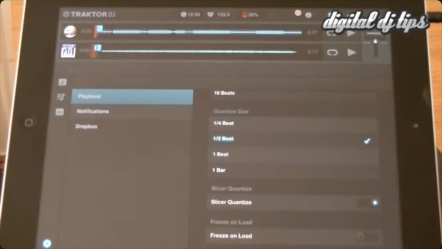
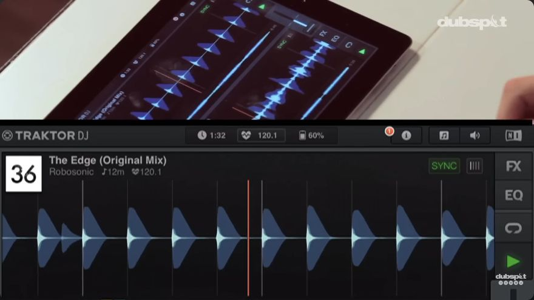

# Period reviews: quantise preferences and early Play

Scope reviewed on 30 October 2026: this document records original-product requirements or dated reference research. It does not certify current replica implementation. See [current shared implementation and verification](../../Replica/Status.md). Original evidence dates and unresolved fidelity requirements are retained.

Reviewed on 21 October 2026 from the Mac. The gig iPad was not accessed. These sources describe the original 2013 app; they do not establish that every detail stayed identical in 1.6.8.

The two main gaps now have stronger historical evidence: an iPad preferences screen and an explicit explanation of deferred ordinary Play. The connection between those two behaviours still needs measurement.

The [later 1.x follow-up](09-later-1x-play-and-cancellation.md) extends the menu evidence into 2017. Play-policy mapping and pending-start cancellation remain unresolved.

## The original iPad quantise menu

Digital DJ Tips' [21 February 2013 talkthrough, 4:13–5:05](https://www.youtube.com/watch?v=Oc4OBDCZnpc&t=253s) shows **browser → bottom-left gear → Playback**. The saved frame at 4:38.840 shows the complete Quantize Size group. The presenter identifies **½ beat as the default**. A separate **Slicer Quantize** switch and **Freeze on Load** control are visible. **D, S21**.

| Visible label | Interval in beats | Boundary spacing at 120 BPM, calculated |
| --- | ---: | ---: |
| 1/4 Beat | 0.25 | 125 ms |
| 1/2 Beat | 0.5 | 250 ms |
| 1 Beat | 1 | 500 ms |
| 1 Bar | 4 in 4/4 | 2 seconds |

The last column explains scale; it is not a measured Play delay. No Off choice appears in this group. Slicer Quantize is a distinct switch. Its displayed state is not proof of its factory default. [S21]

Phil Morse's [2 May 2013 iPhone review, Music library section](https://www.digitaldjtips.com/reviews/traktor-dj-iphone/) independently lists the same four sizes. That corroborates the contemporary product family; the iPad frame supplies platform-specific evidence. **S22**.

## Early Play has explicit period support

In [Dubspot's 30 April 2013 iPad tutorial, 7:23–7:37](https://www.youtube.com/watch?v=5Rd73mY60FE&t=443s), Endo explains that ordinary Play on the incoming deck will **“wait for the first beat of the measure”**. Both decks were placed in Sync at 5:33–5:48. He demonstrates an entry at about 7:46–8:00. **D, S20**.

This supports the user's reported workflow. It describes bar alignment, not recognition of an 8/16/32-bar phrase. The split overhead/screen presentation is not a calibrated input-to-audio trace. The quantise preference is not shown during this explanation. [S20]

## What governs each action

| Action or control | Historical evidence | Exact remaining question |
| --- | --- | --- |
| Hotcue recall | Configurable trigger delay in NI's app chapter [S1 §5.1.2] | Boundary origin, action edge, retrigger and source-phase treatment |
| Freeze triggering | Launch-day hands-on review connects Freeze quantisation to preferences [S27] | Which operations use Quantize Size versus the separate switch |
| Loop Slicer | Quantise-dependent chopping described at 10:19–10:34 [S21] | Effect of Slicer Quantize off; hold, release and repeated taps |
| Ordinary synced Play | Deferred measure entry described above [S20] | Fixed bar policy, preference-dependent policy, or source-phase alignment |
| Pause and loop entry/exit | No complete per-setting timing account found in this pass | Immediate or scheduled; pending-command interactions |

Do not implement one universal quantisation rule from this evidence. In particular, the sources do not justify either `Play always follows Quantize Size` or `Play always waits one bar in every state`. They also do not justify replacing queued Play with immediate playback.

For the proposed rebuild, keep an action's scheduling policy separate from the user preference until reference observations settle the mapping. A menu interval, a launch boundary, and a cue's source position are different data.

## Master-tempo corroboration

The [Digital DJ Tips launch review](https://www.digitaldjtips.com/reviews/traktor-dj-ipad/) describes the central BPM wheel as changing tracks whose Sync button is active. [Resident Advisor's 26 February 2013 test](https://ra.co/reviews/12524) describes disabling Sync for one track and using the global wheel for the other. These are useful scope observations alongside NI's wheel tutorial. **S23/S25**.

The [7 March 2013 AMAZONA review, page 2](https://www.amazona.de/test-native-instruments-traktor-dj-app/2/) reports global tempo to one decimal place and optional measure-aligned starts. This corroborates the workflow; it does not measure wheel resolution, acceleration, or queued-tempo handling. **S26**.

## Additional gesture lead

Endo's [8 May follow-up, 10:29–10:34](https://www.youtube.com/watch?v=kc99WythujM&t=629s) describes dismissing a loop with a **two-finger downward swipe**. This is a clearer captioned instruction than the ambiguous NI Performing passage. Only selected captions from this follow-up were inspected; the gesture still needs visual and installed-build confirmation. **S24**.

## What is closed, and what remains open

- The launch-era iPad quantise group and stated default are historically established. Q01 now concerns installed-build differences and persistence.
- Ordinary Play's deferred bar entry has documentary support. Its exact scheduler remains unmeasured.
- Q02 must distinguish Play, Hotcue, Freeze and Loop Slicer. Include Slicer Quantize on/off as a separate test dimension.
- Q03–Q10 remain open: input edge, clock/bar origin, cancellation, tempo changes while pending, source capture, setting changes while pending, near-boundary handling, and phase correction.

The most useful later experiment is a controlled comparison of all four sizes with identical source cues and early Play offsets. Keep Slicer Quantize fixed, then vary it independently for slice actions. Record transport movement and audio onset separately. Repeat with a cue on beat 3 and with the incoming deck unsynced. This can distinguish several plausible policies that an edited demonstration cannot separate.

Those are future reference trials, preferably on a separate test setup. This research did not connect to, change, reset, or import anything into the performance iPad.

## Review method and limits

The complete English auto-generated caption tracks for S20/S21 were read, with selected scenes inspected in the browser player. S24 received a focused caption review. Publication dates came from expanded video details. No independent audio measurement was made. Written reviews were read for the claims cited above; no paywall was bypassed.

The [period-source manifest](sources/period-review-manifest.json) records URLs, platform scope, caption hashes, review coverage and saved-frame hashes. Full captions remain temporary research inputs; they are not reproduced in this dossier. Later DJ 2 menus, current Pro behaviour, and undated recollections were not used to establish these 1.x settings.
